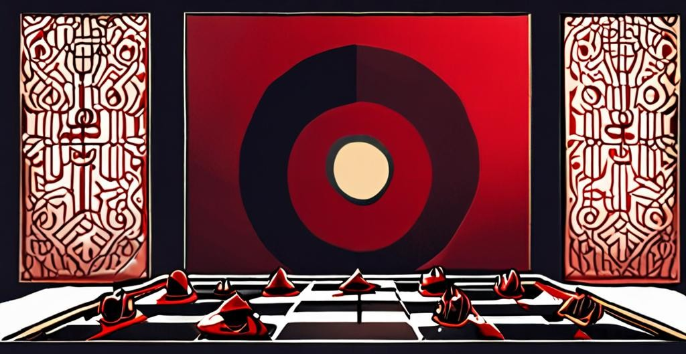
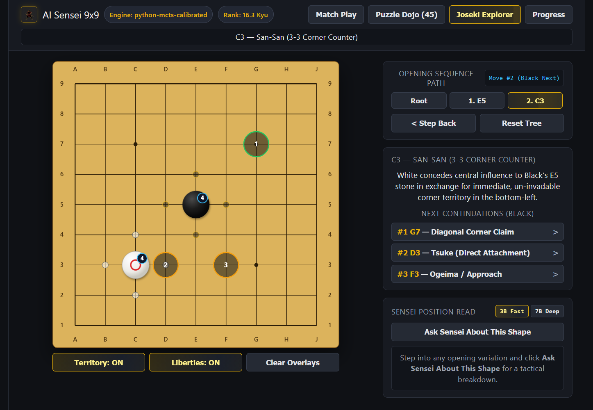

# AI Sensei 9x9 — Local-First Baduk Dojo

An interactive 9x9 Go (Baduk) trainer pairing a calibrated 30 Kyu – 1 Dan engine, spatial-grounded local Ollama coaching, and a progressive High School-to-College puzzle curriculum.

---

## Demo Walkthrough

<div align="center">
  <video src="https://github.com/user-attachments/assets/1b1e3d7f-74ef-4450-ba9e-8e09875fb0d7" width="100%" controls autoplay loop muted></video>
</div>

### 9x9 Opening & Joseki Explorer Preview



---

## Why AI Sensei 9x9?

> **TL;DR:** A local-first 9x9 Go dojo built to take a pure beginner from **30 Kyu → 1 Dan** through visual board overlays (`Territory + Early-Game Influence` & `Chain Liberties`), an interactive **9x9 Opening & Joseki Explorer**, toggleable **3B Fast / 7B Deep** local Ollama coaching, SGF game review, and a 7-module High School-to-College puzzle curriculum backed by an honest SQLite skill rubric.

Most Go apps treat **20 Kyu** as "beginner" and drop 30-Kyu newcomers straight into cryptic life-and-death puzzles without explaining _how to build from an empty board_ or _why_ a move works. **AI Sensei 9x9** bridges that gap through visual feedback, immediate tactical explanations, and weighted progression metrics:

- **Calibrated AI Opponent (`30 Kyu` → `1 Dan`) & Endgame Pass Detection:** Scales candidate pool breadth, tactical reading depth, and Monte Carlo rollouts so novice ranks play genuine exploratory shapes while Dan ranks punish overplays—and automatically detects when all territory borders are sealed (zero neutral _dame_ left) to recommend passing instead of eye-filling.
- **Interactive Rank 1–4 Hint Silhouettes & `3B Fast` / `7B Deep` Toggle:** Project the engine's top 4 candidate moves onto the SVG Goban in <150 ms without blocking board interaction. Switch on the fly between **`3B Fast`** (`qwen2.5-coder:3b`, ~2s tactical reads for rapid puzzle reps on CPU/RAM) and **`7B Deep`** (`qwen2.5-coder:7b`, deeper post-game analysis), and click any selected silhouette again to place the stone.
- **9x9 Opening & Joseki Explorer:** Interactive move-tree explorer covering **Tengen (`E5`)**, **San-San (`3-3`)**, **Komoku (`3-4`)**, and **Hoshi (`4-4`)** 9x9 opening frameworks with clickable numbered continuations (`#1`–`#4`), breadcrumb navigation, Japanese/English Go terminology, and one-click Sensei shape reads.
- **Spatial-Grounded Sensei Explanations:** Serializes exact stone inventories, orthogonal neighbor states, and Atari chain scans before prompting the local LLM—eliminating coordinate hallucinations.
- **Visual Goban Overlays & Board-Footer Advantage Bar:** Toggle **`Territory: ON`** (displaying both 100% sealed territory squares and early-game Manhattan influence dots before walls close) and **`Liberties: ON`** (inward-aligned liberty badges on every connected stone chain with crimson Atari alerts), paired with a live `#349259` emerald **Area Advantage Bar** right beneath the board.
- **High School → College Puzzle Dojo (7 Modules, 45+ Drills):** Auto-discovering JSON curriculum packs covering empty-board openings, multi-stone chain liberties, post-move-5 midgame awareness, cuts/connections, two-eye life/death, ladders/nets, and endgame _Yose_—complete with pre-drill **Sensei Principle** callouts and multi-step interactive opponent replies.
- **SGF Export/Import & SQLite Teacher's Rubric (`backend/data/metrics.db`):** Export matches to standard `.sgf` files or import games for Sensei review, while SQLite tracks continuous floating-point Kyu/Dan rating weighted separately for live matches (Exam weight, with loss degradation) and puzzle drills (Lab weight & first-try accuracy).

### Roadmap

- **Curriculum & Opening Tree Expansion:** Continual addition of High School & College JSON drills and deeper 9x9 _Joseki_ variations.
- **13x13 Board Size Progression:** Optional `9x9` / `13x13` board toggle to bridge compact tactical mastery into side-territory frameworks (_moyo_) and invasion timing.
- **KataGo / GNU Go Engine Hook:** Drop-in neural policy/value integration via `backend/engine_bridge.py` for high-Kyu and Dan-level sparring once foundational 30k–15k mastery is locked in.

---

## Architecture

```text
baduk-trainer/
├── backend/
│   ├── main.py              # FastAPI REST endpoints (/ai-move, /hints, /explain, /joseki, /puzzles, /metrics)
│   ├── go_rules.py          # 9x9 rules engine, liberty flood-fill, Ko validation, area scoring
│   ├── engine_bridge.py     # 30k–1d calibrated MCTS/heuristic engine (+ sealed-border pass & KataGo hook)
│   ├── sensei_agent.py      # Spatial-grounded Ollama client (qwen2.5-coder:7b / 3b toggle)
│   ├── metrics_db.py        # SQLite persistence for weighted rank rubric & match history
│   ├── joseki/              # Interactive 9x9 opening & joseki variation tree (9x9_openings.json)
│   └── puzzles/             # Auto-loaded JSON curriculum packs (01_opening -> 07_endgame_yose)
└── frontend/
    └── src/
        ├── components/
        │   └── Goban9x9.jsx # Responsive SVG 9x9 board with influence heatmap, liberties & hint overlays
        ├── utils/
        │   └── goLogic.js   # Client-side Go rules, SGF import/export, influence & territory estimator
        └── App.jsx          # Match Play, Puzzle Dojo, Joseki Explorer, Coaching & Progress Dashboard
```

---

## Local Setup & Run

**1. Prerequisites**

- Python 3.11+
- Node.js 20+
- Ollama running locally with qwen2.5-coder:7b (and optional qwen2.5-coder:3b fast fallback):

```bash
ollama pull qwen2.5-coder:7b
ollama pull qwen2.5-coder:3b
```

**2. Start the FastAPI Backend**

```powershell
cd backend
python -m venv .venv
.\.venv\Scripts\Activate.ps1
pip install -r requirements.txt
uvicorn main:app --reload --port 8000
```

**3. Start the Vite React Frontend**

```powershell
cd frontend
npm install
npm run dev
```

> Open http://localhost:5173 in your browser.
